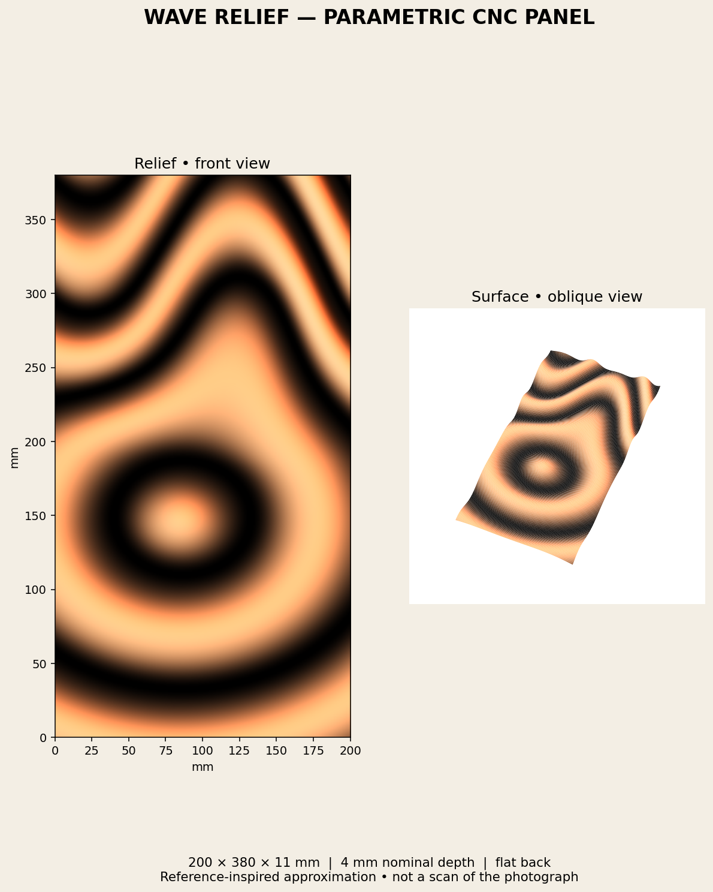
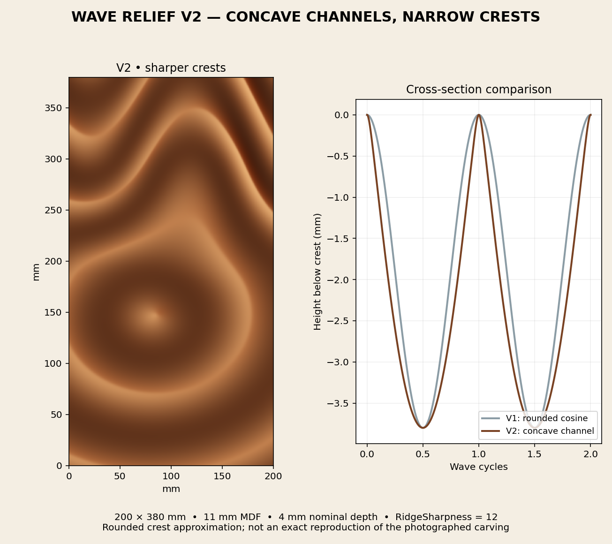

# Fusion 360 Wave Relief

Create editable, flowing relief panels in Autodesk Fusion with two original Python scripts by **Gerald Jaideep**. Both versions build a new parametric design with a flat back and controls for panel dimensions, wave density, centre position, oval proportions and phase.

**MIT licensed · V1.0.3 and V2.0.0 · No external Python packages required in Fusion**

| Version | Surface | Sampling | Script folder |
|---|---|---|---|
| V1.0.3 | Broad, rounded cosine waves | 49 sections × 41 fit points | `v1/WaveRelief_v103` |
| V2.0.0 | Concave channels with narrow, rounded crests | 61 sections, 41 base points plus adaptive crest samples | `v2/WaveRelief_v2` |

Default panel: **200 × 380 mm**, based on **11 mm stock** and **4 mm nominal carving depth**. V2 adds editable `RidgeSharpness`; crest allowance is 0.15 mm in V1 and 0.20 mm in V2. The finished height is slightly below stock thickness.

## Start here

1. Download and extract this repository or a version ZIP from Releases.
2. Open Fusion’s **Scripts and Add-Ins** dialog, select **Scripts**, and use **+** to register the appropriate script folder above.
3. Run `WaveRelief_v103` or `WaveRelief_v2`. Generation can take several minutes; the progress dialog reports the current section.
4. Save the completed design as F3D, then use **Modify → Change Parameters** to edit it.

Read the [installation guide](docs/INSTALLATION.md), [V1 parameter guide](v1/README.md), or [V2 parameter guide](v2/README.md).

## Original design previews

These are the original mathematical profile previews supplied with the source packages, not Fusion screenshots or photographs of machined panels.

## Included files

Each version includes the actual Fusion script and profile helper, a manifest, fixed-geometry STEP/STL companions, the original preview and export validation data. STEP/STL files have no editable Fusion parameter history. The portable exporter itself was not present in the recovered packages and is not included.

## Verification and limits

Recovered desktop logs for both versions end with **COMPLETE: one solid created**. This release preparation also checks Python syntax, manifests, source fidelity and analytic profile samples. It does not constitute a new full Fusion compatibility test. See [verification and provenance](docs/VERIFICATION.md).

The original STEP validation reports a valid single solid for both versions. V2’s recorded maximum sampled error against the analytic field is approximately **0.68 mm**; independently generated STEP geometry and native Fusion lofts can differ. Large parameter edits may require regeneration. V2 refreshes crest anchors when rerun with the edited V2 design active; expressions referencing custom parameters are not supported by that rebuild.

These packages generate geometry, not toolpaths or G-code. Inspect the actual body, allow for clamps and tool clearance, and simulate the manufacturing setup for your machine. No machined-result validation is claimed.

## Development and support

Report reproducible issues through this repository’s Issues page with the version, Fusion build, operating system, parameter values and relevant log excerpt. Remove local paths before sharing logs. See [contributing](CONTRIBUTING.md), [changelog](CHANGELOG.md) and [Autodesk submission materials](docs/autodesk/README.md).

Copyright © 2026 Gerald Jaideep. Distributed under the [MIT License](LICENSE). Autodesk Fusion is a product of Autodesk; this project is independently authored and does not claim Autodesk approval.
